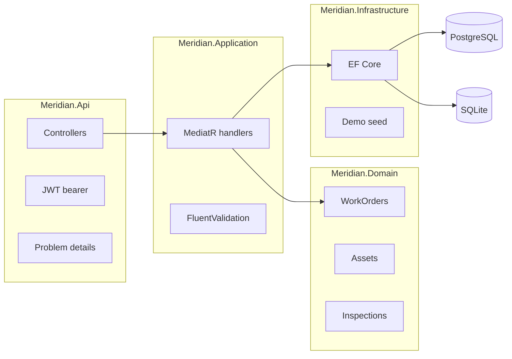

# Meridian

Meridian is a field-operations API for equipment maintenance. Crews log work orders against substations, generation units, and compressor stations, record inspections, and read a small operational dashboard. It is an original portfolio project in the kind of domain Sydney Ani has worked in: C# services for energy operations, with a Flutter client planned on top of this API.

The sample data is synthetic. Nothing here is a real utility, person, or asset.

## Architecture

The API is a single ASP.NET Core process split into four projects so the business rules do not depend on HTTP or Entity Framework.



A request takes one path: the controller builds a command, MediatR runs validation, the handler loads aggregates, the domain accepts or rejects the change, and EF Core saves it. HTTP status codes are mapped in one exception handler, so handlers throw `NotFoundException`, `ForbiddenException`, or `DomainException` instead of building `ActionResult`s.

| Project | Responsibility |
| --- | --- |
| `Meridian.Domain` | Aggregates, the work-order state machine, and invariant checks. No NuGet dependencies. |
| `Meridian.Application` | Use cases, authorization rules, and FluentValidation. |
| `Meridian.Infrastructure` | EF Core, password hashing, refresh tokens, and the demo seed. |
| `Meridian.Api` | Controllers, JWT bearer auth, Serilog, Swagger, health checks. |

PostgreSQL is the production provider. Local development and tests use SQLite so `dotnet test` does not need Docker. Migrations target PostgreSQL. SQLite calls `EnsureCreated` from the same model, including a value converter that stores instants as UTC `DateTime` so both engines can sort them.

## Quickstart

Requires the .NET 8 SDK.

```bash
dotnet run --project backend/src/Meridian.Api
```

The Development environment seeds the database and listens on `http://localhost:8080`. Swagger UI is at [http://localhost:8080/swagger](http://localhost:8080/swagger). `backend/src/Meridian.Api/Meridian.Api.http` has the same calls for an HTTP client.

Demo password for every account: `Meridian#demo1`

| Email | Role |
| --- | --- |
| `maya.okonkwo@meridian.demo` | Technician |
| `luis.ortega@meridian.demo` | Technician |
| `priya.nair@meridian.demo` | Supervisor |
| `sam.okada@meridian.demo` | Admin |

Technicians can open work and change jobs they created or are assigned to. They can assign a job only to themselves. Supervisors and admins can change any work order and edit the asset register. Anyone signed in can add a handoff note, including on a closed job.

## API

All routes except login, refresh, logout, and the health checks require `Authorization: Bearer <accessToken>`.

| Method | Path | Purpose |
| --- | --- | --- |
| POST | `/api/auth/login` | Exchange email and password for access and refresh tokens |
| POST | `/api/auth/refresh` | Rotate a refresh token. Reuse of an old token revokes the user's sessions |
| POST | `/api/auth/logout` | Revoke a refresh token |
| GET | `/api/auth/me` | Current user |
| GET | `/api/users` | Active crew, for assignee pickers |
| GET | `/api/sites` | Sites |
| GET | `/api/assets` | Search assets |
| POST | `/api/assets` | Register an asset. Supervisor or admin |
| PUT | `/api/assets/{id}` | Update an asset. Supervisor or admin |
| GET | `/api/work-orders` | Search work orders |
| POST | `/api/work-orders` | Open a work order |
| GET | `/api/work-orders/{id}` | Detail, comments, and allowed transitions |
| PUT | `/api/work-orders/{id}` | Edit details, assignment, and labor |
| POST | `/api/work-orders/{id}/transitions` | Move status |
| POST | `/api/work-orders/{id}/comments` | Add a handoff note |
| GET | `/api/inspections` | Search inspections |
| POST | `/api/inspections` | Record an inspection and update the asset's last-inspected time |
| GET | `/api/dashboard/summary` | Counts for the shift board |
| GET | `/health/live` | Process is up |
| GET | `/health/ready` | Database responds |

Work orders move only along these edges:

```text
Open -> InProgress | Cancelled
InProgress -> WaitingParts | Completed | Cancelled
WaitingParts -> InProgress | Cancelled
```

Completing a job requires labor hours greater than zero. The detail payload includes `allowedTransitions` so a client does not duplicate the rules.

Validation failures return 400 with an `errors` object. Domain rule failures return 422. Conflicts, such as a duplicate asset tag, return 409.

Access tokens last 8 hours by default, which covers a shift. Refresh tokens last 14 days and rotate on every use. Set `Jwt:SigningKey` to at least 32 bytes outside local development. Set `Seed:Enabled` to `false` when the database should not be filled with demo crew.

`Database:Provider` is `Sqlite` or `Postgres`.

## Tests

```bash
dotnet test backend/Meridian.sln
```

- Domain tests cover the state machine, asset tags, labor rounding, and inspection rules.
- Application tests cover validation, assignment rules, and a failed login.
- API tests boot the real pipeline with `WebApplicationFactory` and a private SQLite file: login, refresh reuse, a work order from open to complete, authorization, and the seeded dashboard counts.

## Configuration

`appsettings.json` defaults to a local SQLite file and leaves seeding off. `appsettings.Development.json` turns seeding on. The signing key in source is a development key only.
